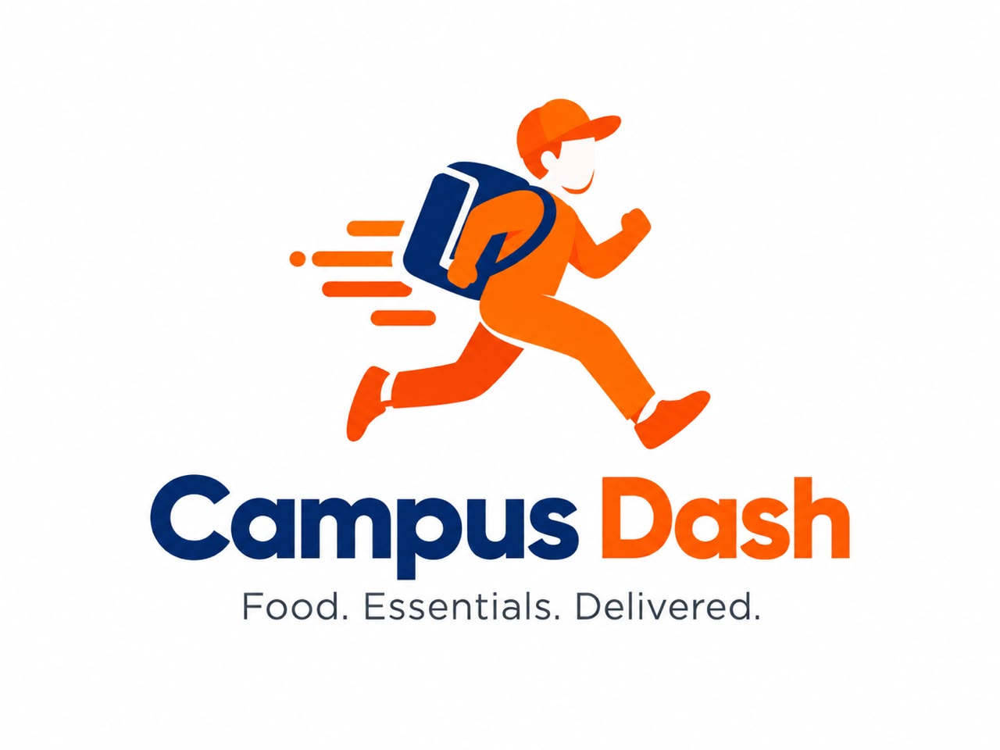
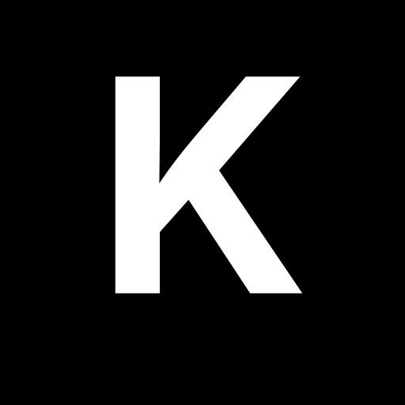
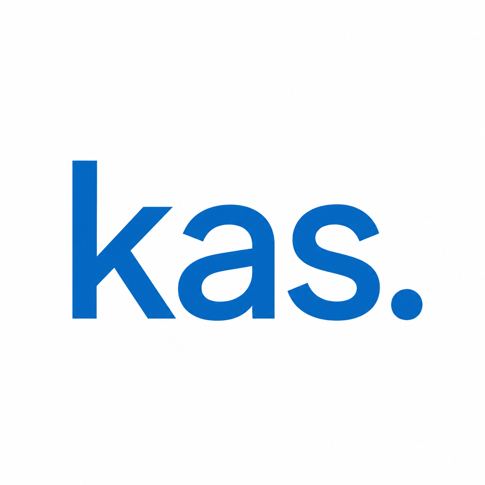

<h1 align="center">Case studies</h1>

  Technical write-ups of systems whose source code is private. 
  Problem, role and engineering decisions only. No client data or implementation details.

 

<table align="center">
  <tr>
    <td align="center" width="200">
      
       <b><a href="youth-parliament.md">Youth Parliament Ghana</a></b>
       Voting platform · commissioned work
    </td>
    <td align="center" width="200">
      
       <b><a href="campus-dash.md">Campus Dash</a></b>
       Campus food ordering · KAS Maven product
       <a href="https://campusdash.app">Live product ↗</a>
    </td>
    <td align="center" width="200">
      
       <b><a href="kasem.md">Kasem</a></b>
       Anonymous reporting · KAS Maven product
       <a href="https://kasem.app">Live product ↗</a>
    </td>
  </tr>
</table>

 

  
   
  <a href="https://github.com/aakwadwo">Kwadwo Asumadu</a> · <a href="https://www.linkedin.com/in/kwadwo-asumadu/">LinkedIn</a>

